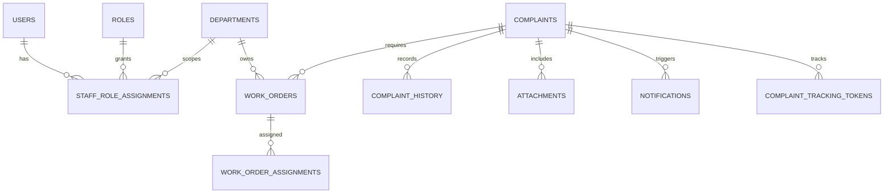

# Campus Maintenance Management System: Database Design

## Design principles

- Preserve every existing complaint row, public complaint identifier, current status, and access-code hash. Add schema in place using reviewed, versioned migrations; never recreate or overwrite the database.
- Use PostgreSQL for hosted Vercel traffic and SQLite for local development. Use one SQLAlchemy model/migration history and verify each migration against both database engines.
- Use internal UUIDs for new relationships and keep the current public `complaint_id` as a unique, immutable external identifier. Legacy complaint IDs remain unchanged.
- Store UTC-aware timestamps, normalized foreign keys, explicit state values, and append-only event records. Retain historical text snapshots where a renamed lookup value must remain understandable.
- Keep personal data minimal. No migration should synthesize accounts, email addresses, access credentials, actors, assignments, or historical events that are not present.

## Proposed logical schema

The sections below describe the target relational model. Stage 1 implements the initial identity/security subset in the models and Alembic revision; complaint UUID links, work management, attachments, notifications, and reporting tables remain future migrations. The current migration deliberately leaves existing complaint rows and the integer `complaints.id` intact.

`UUID` below means a canonical 36-character UUID string or SQLAlchemy UUID mapping with a SQLite-compatible representation. `TIMESTAMP` means UTC-aware in PostgreSQL; SQLite stores a consistent ISO-8601 UTC representation. Lookup values should be seeded and changed through reviewed admin actions, not arbitrary text entered at runtime.

### Identity, roles, and departments

| Table | Main columns and constraints | Purpose |
| --- | --- | --- |
| `users` | `user_id UUID PK`; `account_kind` (`student`/`staff`); future nullable campus subject/ID; institutional `email`; unique non-null `normalized_email`; `display_name`; `password_hash` nullable; future `auth_provider`; `status` (`invited`, `active`, `suspended`, `disabled`); `session_version`; `email_verified_at`; `last_login_at`; `created_at`, `updated_at`; future `disabled_at` | Individual identities. Stage 1 uses required email and password for invited staff. SSO-only accounts and student accounts may need nullable auth fields in a future reviewed migration. Existing complaint reporters do not become users unless they explicitly authenticate/link. |
| `roles` | `role_id`; unique `role_key`; `display_name`; `is_system_role`; `active` | Seed `SUPER_ADMIN`, `MAINTENANCE_HEAD`, `DEPARTMENT_SUPERVISOR`, `TECHNICIAN`, and `STUDENT`. |
| `permissions` | `permission_id`; unique `permission_key`; `description` | Catalog of server-side actions such as complaint read, triage, assign, resolve, manage staff, manage departments, manage SLA policy, and view audit. |
| `role_permissions` | `(role_id, permission_id) PK`; FKs to roles/permissions | Role-to-permission mapping. Keep department scope out of this global mapping. |
| `staff_role_assignments` | `assignment_id`; `user_id FK`; `role_key FK`; nullable `department_id FK`; `assigned_by_user_id FK`; `assigned_at`; nullable `revoked_at`; optional `expires_at`; check: Super Admin/Maintenance Head are global, Supervisor/Technician require a department; unique active assignment for user/role/department | Individual staff role grants and department scope. The application must validate role/department combinations, not trust submitted IDs. |
| `departments` | `department_id`; unique `department_code`; `name`; `description`; `active`; `created_at`; nullable `archived_at` | Configurable Electrical, Civil, Plumbing, Housekeeping, Network/IT, and other campus units. Archive rather than delete when referenced. |

Use normalized lowercase email for uniqueness if email is used. Do not make roll number a login secret. Decide whether multiple departments per supervisor/technician are allowed; the schema supports multiple active assignments.

### Campus locations, categories, and routing

| Table | Main columns and constraints | Purpose |
| --- | --- | --- |
| `campus_locations` | `location_id`; nullable `parent_location_id FK`; `location_type` (`campus`, `building`, `block`, `floor`, `room`, `area`); `code`; `name`; `active`; `legacy_location_text`; unique within parent on normalized code/name | Hierarchical campus location. Preserve the original free-text value on legacy complaints. |
| `complaint_categories` | `category_id`; unique `category_key`; `name`; nullable `default_department_id FK`; `active`; `sort_order` | Configurable categories with suggested default department. Human triage may override. |
| `routing_rules` | `routing_rule_id`; category/location/severity predicates; `department_id FK`; `priority`; `active`; effective start/end; created/updated by | Optional deterministic default routing. Changes are audited; ambiguous or unmatched complaints remain in a triage queue. |
| `sla_policies` | `sla_policy_id`; `department_id FK` nullable for global fallback; severity; response/resolution target minutes; business-calendar key; effective dates; active | Versioned SLA targets. Store the policy snapshot and computed deadline on the complaint/work order so policy edits do not rewrite old deadlines. |

Use stable QR IDs or location codes so printed codes keep working when a display name changes. The QR should resolve to a location record and must not let a user forge a different location by editing a hidden field.

### Complaints, work, lifecycle, and history

| Table | Main columns and constraints | Purpose |
| --- | --- | --- |
| `complaints` | `complaint_uuid PK`; unique `complaint_id` (legacy/public ID); nullable `student_user_id FK`; `reporter_name_snapshot`; nullable `reporter_roll_snapshot`; nullable `category_id FK`; `category_snapshot`; nullable `location_id FK`; `location_text_snapshot`; nullable `department_id FK` (current routing); `description`; `severity` (`low`, `normal`, `high`, `emergency`); `priority` (queue ordering value); `workflow_state`; `legacy_status` nullable; nullable `duplicate_of_complaint_uuid FK`; nullable `sla_policy_id FK`; nullable `response_due_at`; nullable `resolution_due_at`; `submitted_at`; `updated_at`; nullable `resolved_at`; nullable `closed_at`; `version` | Current complaint state plus compatibility fields. Keep `complaint_id` exactly as issued. `legacy_status` records the original label when workflow mapping cannot be represented exactly. |
| `complaint_tracking_tokens` | `tracking_token_id`; `complaint_uuid FK`; unique `token_hash`; `created_at`; `expires_at`; `revoked_at`; nullable `last_used_at`; optional `created_by_user_id FK` | Hashed, revocable, high-entropy bearer links for secure tracking/receipt recovery. Never store the raw token. |
| `work_orders` | `work_order_id`; `complaint_uuid FK`; `department_id FK`; nullable `assigned_technician_assignment_id FK`; `work_state`; `priority`; nullable `response_due_at`; nullable `resolution_due_at`; `created_by_user_id FK`; `created_at`; `accepted_at`; `started_at`; `blocked_at`; `completed_at`; `resolution_notes`; `version` | Actionable unit of work. A complaint may have multiple work orders if several departments must contribute. |
| `complaint_history` | `history_id`; `complaint_uuid FK`; nullable `work_order_id FK`; `event_type`; nullable `from_state`; nullable `to_state`; nullable `actor_user_id FK`; `visibility` (`student`, `staff`, `restricted`); `summary`; optional redacted `metadata_json`; `occurred_at`; nullable `request_id` | Append-only timeline and state-change evidence. Never update an event to rewrite history; correct by adding a correction event. |
| `work_order_assignments` | `work_order_assignment_id`; `work_order_id FK`; `staff_assignment_id FK`; `assigned_by_user_id FK`; `assigned_at`; nullable `accepted_at`; nullable `ended_at`; `end_reason` | Assignment/reassignment history and workload accounting. Current assignment can be derived from the one active row or mirrored on `work_orders` with a constraint. |
| `complaint_links` | `(source_complaint_uuid, target_complaint_uuid, link_type) PK`; actor; timestamp | Explicit duplicate/related complaint links without deleting or merging away original IDs or reporter history. `duplicate_of` may be a convenience pointer; this table holds auditable relationships. |
| `complaint_feedback` | `feedback_id`; `complaint_uuid FK`; nullable `student_user_id FK`; rating with bounds; optional comment; `created_at`; unique policy for one response per complaint/account or token | Student satisfaction and resolution feedback. Keep comments private according to retention policy. |

### Attachments, notifications, and audit

| Table | Main columns and constraints | Purpose |
| --- | --- | --- |
| `attachments` | `attachment_id`; `complaint_uuid FK`; nullable `work_order_id FK`; nullable `uploaded_by_user_id FK`; `object_key` unique; `original_filename` sanitized; detected `mime_type`; `size_bytes` with positive/max check; `sha256`; `scan_state`; `visibility`; `created_at`; nullable `deleted_at` | Metadata for private durable object storage. File bytes do not go into PostgreSQL or the Vercel filesystem. Require authorization on every download. |
| `notification_preferences` | `user_id FK`; channel; enabled; verified destination reference; updated timestamp; composite unique | Per-user opt-in/opt-out controls. Do not put raw addresses in event payloads. |
| `notifications` | `notification_id`; nullable `user_id FK`; `complaint_uuid FK`; `event_key` idempotency key; channel; template key; delivery state; attempt count; `available_at`; `sent_at`; `created_at`; redacted `last_error_code` | Transactional outbox and delivery state. Insert in the same transaction as the business event; provider delivery is retryable and idempotent. |
| `audit_logs` | `audit_id`; nullable `actor_user_id FK`; `action`; `subject_type`; `subject_id`; outcome; timestamp; request/correlation ID; redacted `before_json`/`after_json`; optional privacy-reviewed network fingerprint | Append-only record of access-control and administrative actions. Restrict reads; never log secrets or full sensitive complaint text. |
| `auth_tokens` | `auth_token_id`; `user_id FK`; `purpose` (`invite`, `password_reset`, `email_verify`); unique `token_hash`; `created_at`; `expires_at`; nullable `consumed_at`; nullable `created_by_user_id FK` | Single-use hashed invitation and recovery tokens. |
| `login_attempt_buckets` | keyed by a hash of normalized account identifier and privacy-reviewed network key; bucket start; failure count; blocked-until; updated timestamp | Shared, bounded login rate limiting across Vercel instances. Use atomic updates and retention/cleanup. Do not persist raw passwords or reset tokens. |

### Status and severity vocabularies

Use text plus application validation and database `CHECK` constraints (or seeded lookup tables) so values remain portable across SQLite and PostgreSQL. Do not use a single field to mean both impact and urgency.

- **Severity:** `low`, `normal`, `high`, `emergency` describes safety/impact.
- **Priority:** derived queue rank that may incorporate severity, age, SLA remaining, and policy. Manual overrides require a reason and audit event.
- **Complaint workflow:** `submitted`, `triage`, `assigned`, `in_progress`, `resolution_review`, `resolved`, `closed`, `reopened`, `cancelled`, `duplicate`. Define allowed edges in the service layer and record each transition in `complaint_history`.
- **Work order:** `queued`, `assigned`, `accepted`, `in_progress`, `blocked`, `ready_for_review`, `completed`, `cancelled`. Work-order completion does not automatically close a complaint if student confirmation or multi-department work remains.

## Relationships and key indexes

At minimum index:

- `complaints(complaint_id)` unique; `complaints(workflow_state, priority, submitted_at)`; `complaints(department_id, workflow_state, priority, submitted_at)`; `complaints(student_user_id, submitted_at)`; `complaints(location_id, submitted_at)`; `complaints(duplicate_of_complaint_uuid)`.
- `work_orders(department_id, work_state, priority, resolution_due_at)` and `work_orders(assigned_technician_assignment_id, work_state)`.
- `complaint_history(complaint_uuid, occurred_at, history_id)` and `complaint_history(work_order_id, occurred_at)`.
- `staff_role_assignments(user_id, revoked_at)` and `staff_role_assignments(department_id, role_id, revoked_at)`.
- `notifications(delivery_state, available_at)` and unique `notifications(event_key)`; `attachments(complaint_uuid, created_at)`; unique token hashes for auth/tracking.

Choose `ON DELETE RESTRICT` for referenced users, complaints, departments, categories, and work orders. Deactivate/archive records instead of deleting them. Apply a documented retention/anonymization process only after institutional approval; never cascade-delete complaint history or audit evidence.

For future complaint UUID relationships, introduce a separate mapping/extension table keyed by the existing integer `complaints.id` and associate its stable UUID there. Do not replace or rewrite `complaints.id` or `complaint_id`; this Stage 1 migration creates no complaint UUIDs and no links to users.

## Safe migration from the existing database

### Current source schema

The inspected SQLite file contains only `complaints`. The current columns are `id`, `complaint_id`, `name`, `location`, `category`, `description`, `status`, `created_at`, `priority`, `roll_number`, and `access_code_hash`. The pre-Stage-1 PostgreSQL initializer used a generated identity `id` and the same logical complaint fields. The local database schema was inspected read-only; rows and contents were not accessed. No PostgreSQL URL is configured locally, so a live Preview schema was not inspected.

Stage 1 adds checked-in Alembic revision `0001_identity_foundation`. It creates the initial identity/security tables and seeds roles, permissions, and six departments. It creates `complaints` only when absent and adds only missing `priority`, `roll_number`, or `access_code_hash` columns to an older table. The application no longer calls DDL during import or startup. This revision has been tested only against temporary synthetic SQLite databases; it has not been applied to the local complaint database or any Neon database.

### Expand-and-backfill sequence

1. **Inventory and recoverability:** record schema/version and row counts in a restricted operational runbook; take a provider-supported backup/snapshot and prove restore into an isolated test database. The procedure is documented in `SECURITY_NOTES.md`, but no real-data backup or restore has been executed. Do not print or export complaint data into source control or test output.
2. **Baseline migration:** Stage 1 now provides the first Alembic revision for the legacy complaint table plus identity foundation. Existing installs still require a read-only schema inventory and isolated rehearsal before an operator explicitly runs migrations. No production/Preview URL has been migrated.
3. **Expand:** future revisions add new tables and nullable columns/indexes first. Preserve the original complaint columns and `id`; do not rename/drop them. Use transaction-safe operations supported by the target engine and staged indexes where the PostgreSQL table size requires it.
4. **Seed lookups:** add roles/permissions, configurable departments/categories, and location structure. Do not guess department ownership for ambiguous legacy categories.
5. **Backfill without fabrication:** create one new complaint UUID per existing row; copy the existing `complaint_id` exactly. Keep `name`, `roll_number`, `location`, `category`, `description`, `priority`, `status`, `created_at`, and `access_code_hash` unchanged. Store snapshots and link only values that map confidently. Unmapped category/location/department remains unassigned and visible to a triage queue.
6. **Initial timeline event:** add a migration/import event with null actor and source marker. Do not invent who changed a historical status or when it changed. Keep `created_at` as source time and retain the original text. Normalize a UTC timestamp only when the original timezone is known; otherwise mark the imported time as timezone-unknown metadata rather than silently shifting it.
7. **Map workflow cautiously:** map legacy `Pending` to `submitted`, `In Progress` to `in_progress`, and `Resolved` to a resolved legacy state while retaining the exact original `status` in `legacy_status` or an equivalent field. Do not pretend old resolved complaints received student confirmation. Report unrecognized values for manual review without blocking reads.
8. **Retain old tracking:** leave `access_code_hash` intact and keep the current verifier available for old complaints. Do not mint tracking tokens because the original code is not recoverable from its hash. Allow an authenticated student to create a new tracking token only after verifying ownership, or use an approved account-linking process.
9. **Dual-read/release:** deploy code that can read both migrated/new fields and legacy values; verify old QR URLs and complaint IDs. Only then switch writes to the new service/state model. Maintain a rollback window where the old app can still read preserved columns.
10. **Contract later:** remove or make compatibility fields read-only only in a separately reviewed migration after the legacy release is no longer a rollback target. No contract/drop is part of the first rollout.

### SQLite and PostgreSQL migration checks

Migrations must be idempotent only through Alembic revision tracking, not by swallowing all DDL errors. Test a fresh schema and each supported legacy schema shape on both engines. SQLite foreign-key enforcement must be enabled per connection and tested. Validate PostgreSQL constraints/locks, connection pool sizing, and rollback behavior. Use synthetic rows with stable fake IDs/codes for migration tests; never run tests against the live local database or a production Neon database.

