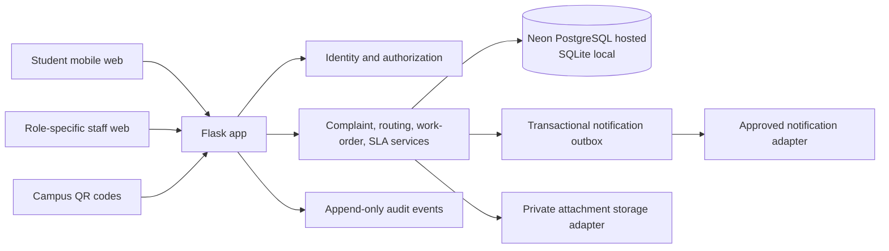

# Campus Maintenance Management System: System Architecture

## Purpose and scope

This document describes a target architecture for expanding the current Flask QR complaint demonstration into a maintainable, multi-role system for IIIT Dharwad. It is a design proposal, not an implementation or a claim that production controls have been verified. No application code, database, deployment, or environment setting was changed for this review.

The pilot is IIIT Dharwad with an expected 50–200 users. It uses individual institutional email/password accounts, with staff invited by a Super Admin and no public staff registration. SSO is deferred until an institutional integration is confirmed. Students initially use complaint-specific secure tracking capabilities. The design keeps a single Flask application and preserves the existing complaint intake, QR flow, public complaint identifiers, local SQLite development, and Neon PostgreSQL hosting. It avoids splitting the initial release into services. Notification and file-storage providers remain decisions to make with the institute; no paid service is assumed.

## Reviewed system today

### Application and routes

The project has one Python application module, `app.py`, with these routes:

| Route | Current behavior |
| --- | --- |
| `GET/POST /` and `/complaint` | Complaint intake; a `location` query parameter locks the QR-selected location. Inserts the complaint and renders its one-time access code. |
| `GET /qr-codes` | Renders the configured campus QR gallery. |
| `GET /qr-code/<location>.svg` | Generates a QR SVG, optionally as a download. |
| `GET/POST /student` | Student tracking by complaint ID plus access code. |
| `GET /staff/login` and `POST /staff/login` | Shared-password staff login. |
| `POST /staff/logout` | Clears the staff session. |
| `GET /dashboard` | Staff complaint list and priority filter. |
| `GET/POST /dashboard/complaint/<complaint_id>` | Staff complaint detail and direct status change. |
| `GET /admin` | Read-only totals and complaint analytics. |

The ten existing templates cover intake, confirmation, QR gallery, student lookup/detail/error, staff login, complaint dashboard/detail, admin analytics, and a not-found page. `static/style.css` and `public/static/style.css` are duplicate copies. The current screens share a navy/white/teal style; they do not yet provide separate operational workspaces for each staff role.

### Data, authentication, and testing

The inspected local SQLite schema has one table, `complaints`: integer `id`, unique `complaint_id`, `name`, `roll_number`, `location`, `category`, `description`, `status`, `priority`, `created_at`, and nullable `access_code_hash`. The PostgreSQL initializer before Stage 1 created the corresponding table with a generated identity key and added `priority`, `roll_number`, and `access_code_hash` as additive columns. The local database was opened read-only for schema inspection; complaint data was not queried. No `DATABASE_URL` is configured locally, so the Neon Preview schema could not be inspected.

SQLite is the default local complaint database. `DATABASE_URL` selects the existing pooled psycopg PostgreSQL connection for complaint routes. SQLAlchemy models and Alembic revision `0001_identity_foundation` now define the identity foundation; Flask import and startup no longer run schema DDL. Migrations are explicit and have only been run against temporary synthetic SQLite fixtures in this stage.

The existing staff routes still use a single configured `ADMIN_PASSWORD`; successful legacy login puts `is_staff` in Flask's signed client-side session. The new individual-account service foundation uses scrypt password hashes, invite/reset token hashes, session-version checks, department-scoped permission evaluation, and database-backed login-attempt buckets, but is not connected to HTTP staff routes. CSRF tokens are checked for POST requests. Student tracking uses salted scrypt hashes for new codes and retains compatibility with legacy SHA-256 hashes. The existing student-code throttle remains process-local.

The current test modules are `test_app.py`, `test_classification.py`, `test_deployment.py`, `test_identity_foundation.py`, `test_migrations.py`, and optional `test_postgres.py`. They cover existing SQLite flows, account/token/session/rate-limit services, department-scope decisions, and synthetic SQLite migration preservation. Model DDL is compiled for SQLite and PostgreSQL. The PostgreSQL integration test is skipped unless `POSTGRES_TEST_DATABASE_URL` is provided; this environment also has no configured `DATABASE_URL`. Full HTTP authorization wiring, attachments, SLAs, and production concurrency remain future work.

### Current limitations and risks to address

- The existing staff HTTP routes still use one shared password, so individual account services are not yet the active staff login system. There is no invitation/reset email delivery or account-management UI.
- `staff_required` only distinguishes staff from anonymous users. It cannot restrict a supervisor or technician to a department or assigned work order.
- Status changes overwrite the current value. No append-only history, actor, resolution notes, assignment trail, or student confirmation is recorded.
- Category, priority, status, and location are simple text values. Categories are keyword-derived and are not reliable department routing rules. Severity and urgency are not distinct.
- The complaint form has a free-text location, not a building/block/floor/room hierarchy. It has no attachment, duplicate, assignment, SLA, notification, or reopening workflow.
- The public complaint ID uses a short random suffix. Do not change IDs already issued; use a separate high-entropy internal key for new relational links and improve new public ID generation without invalidating legacy URLs.
- The public tracking code is eight digits for new reports. Its existing throttle is process-local and resets across workers/restarts; it is not sufficient as the only production brute-force control. The new staff login throttle is database-backed but not connected to a route.
- Flask's default random secret is acceptable only for local fallback. A production secret must be stable and rotated intentionally. New account session-version support exists as a service but is not wired to the old signed `is_staff` session; explicit idle/absolute expiry remains future work.
- `created_at` is a naive local timestamp. New events should use UTC timestamps with timezone information.
- SQLite files are local development data, not durable storage for Vercel serverless instances. Hosted traffic must use PostgreSQL. Import-time DDL has been removed; migration commands must still be rehearsed and run explicitly.
- No hosted PostgreSQL schema/migration test, backup/restore rehearsal, operational alerting, or external attachment store has been verified. These are launch-readiness work, not assumptions to hide in route code.

## Target architecture

### Shape: modular monolith

Keep one Flask deployment with a clear application factory, blueprints, services, repositories, and versioned migrations. This gives the project role separation and testable boundaries without the cost and failure modes of microservices.

Suggested package boundaries:

| Area | Responsibility |
| --- | --- |
| `auth` | Login, logout, invitation redemption, password reset, session lifecycle, login throttling. |
| `authorization` | Permission checks and department/resource scope; deny by default. |
| `student` | Intake, QR context, private tracking, confirmation/reopen, feedback, receipts. |
| `complaints` | Validation, immutable identifiers, duplicate linking, state transitions, routing. |
| `work_orders` | Supervisor queues, technician assignment, work status, resolution evidence. |
| `departments` | Department and campus-location administration. |
| `reports` | Scoped dashboards, SLA/workload and performance summaries. |
| `notifications` | Outbox creation, preferences, delivery state, provider adapter. |
| `audit` | Security/administrative/business audit events with restricted read access. |
| `db` | SQLAlchemy models/repositories and Alembic migration environment. |

Use an application factory to load configuration, register blueprints, establish session/security settings, and expose dependency wiring. Keep route functions thin: authenticate, validate input, call a service, then render or redirect. Put state transitions and scope checks in services as well as route decorators so non-HTTP callers cannot bypass them. Repositories should parameterize queries and avoid leaking cross-department rows.

Use SQLAlchemy with Alembic for a single schema model and versioned migrations. PostgreSQL is authoritative in hosted environments; SQLite remains useful for local development and fast tests. Keep shared data types portable (string-backed identifiers, lookup/check constraints rather than database-only enum assumptions, UTC-aware dates, JSON abstraction only where needed). Exercise migrations against both engines. Do not copy SQLite data to Neon automatically.

### Identity and account lifecycle

- For the pilot, create individual staff accounts through single-use, short-expiry invitations from a Super Admin. Use institutional email normalization/allowlisting and store only a password hash using a vetted password-hashing implementation and current cost settings. Never store or email a reusable plaintext password. SSO remains a future option after the institutional integration is confirmed.
- Password reset uses a single-use, hashed, expiring token and a verified channel; responses must not reveal whether an account exists. Reset invalidates existing sessions and outstanding reset tokens.
- Student identity should use institute SSO if available. Until then, keep a high-entropy per-complaint capability link as the recovery path; do not use roll number as authentication. A link is a bearer secret: store only its hash, keep it out of analytics/referrers/logs, mark responses `no-store`, and support revocation/rotation.
- Keep session data minimal. Use secure, HTTP-only, same-site cookies, a stable production secret, explicit idle and absolute expiry, session version/revocation checks, rotation after authentication/privilege changes, and CSRF protection for every state-changing browser request. Require HTTPS in hosted use.
- Login rate limits must be shared across function instances. A database-backed short-window counter can be an initial solution at this scale; keep it atomic and bounded. If traffic justifies a dedicated shared limiter later, select it deliberately rather than relying on process memory.

### Request and authorization model

Every action requires both a permission and a resource scope. For a department-scoped record, authorize the requested action against the actor's active assignment and the record's current department or work-order assignment. Do this on every read and write, including detail URLs, downloads, exports, and APIs. A hidden link or filtered query is not a security boundary.

Use an explicit service policy such as `can(actor, permission, resource)` with tests for allow and deny cases. Department scope comes from `staff_role_assignments`; an assignment to one department must never imply access to another. Super Admin actions are separately permission-gated and audited. Avoid broad “is staff” fallbacks.

### Compatibility and routes

Keep the existing QR destinations and complaint identifiers usable. Preserve `/`, `/complaint`, `/qr-codes`, `/qr-code/<location>.svg`, and `/student` while introducing role-specific endpoints and layouts. The current `/dashboard`, `/dashboard/complaint/<complaint_id>`, and `/admin` can remain compatibility aliases that require authentication and redirect to the appropriate scoped area after authorization. Do not silently expose existing staff pages under weaker rules during transition.

New complaint creation should return a receipt containing the same public complaint ID format family or a new collision-resistant format, the classification result, and a copyable secure tracking link. Existing IDs and access-code hashes remain valid. No migration should invent student identities, codes, email addresses, audit actors, or assignment history.

### Deployment and operational model

- Vercel remains the Flask request host, with Neon PostgreSQL for durable hosted data. SQLite is local/test only for deployment use.
- Replace schema initialization at import time with a versioned migration command executed as a controlled release step before application code that depends on new columns. Application startup should validate schema version and fail clearly if behind, not run DDL concurrently in every cold start.
- Use a PostgreSQL role for runtime traffic with only required DML rights. Use a separate migration credential with DDL rights. Keep credentials in deployment environment settings; never put them in source or generated artifacts.
- Size connection pools across all possible warm instances, not just one function. Set explicit query timeouts and transaction boundaries. Test pool saturation and transient database errors.
- Keep notifications in a transactional outbox so complaint creation/state changes and notification intent commit together. Delivery is at-least-once with idempotency keys. A Vercel-compatible scheduler/queue or institute-managed worker can drain it; choose only after confirming current platform capabilities and any costs. No provider is assumed.
- Attachment bytes must live in private durable storage, never the Vercel filesystem or public static directory. Use a storage adapter with random object keys, strict MIME/size limits, authorization on retrieval, expiring signed access if supported, and malware scanning where the approved storage path supports it. Keep attachments disabled until storage, retention, and access policies are approved.
- Add structured logs with request/correlation IDs and redaction. Never log access codes, reset/invitation tokens, full complaint descriptions, passwords, or attachment contents. Establish backup retention, restore drills, error alerts, and incident procedures before a production cutover.

## Reuse and redesign

| Existing capability | Treatment |
| --- | --- |
| QR gallery, SVG endpoint, locked QR location | Reuse the flow and route shape; replace hard-coded locations with managed campus-location records and stable QR identifiers. Keep old QR links resolving. |
| Complaint intake validation and public `complaint_id` | Reuse field validation concepts and preserve IDs. Redesign persistence through services, structured locations, category/severity, idempotency, and richer receipt data. |
| Classification/priority keyword rules | Keep as an initial suggestion only. Add department/category configuration and human triage; do not silently treat text keywords as authoritative emergency detection. |
| Scrypt access-code verification and legacy SHA-256 compatibility | Preserve for old complaints. Use new high-entropy capabilities and/or student identity for new tracking; never expose or backfill old secrets. |
| CSRF and parameterized SQL intent | Retain and strengthen using the app-wide security layer, central auth, database abstraction, and security tests. |
| Dashboard and analytics UI | Reuse the visual palette and useful summary concepts. Redesign into separate student, Super Admin, Maintenance Head, Supervisor, and Technician navigation, scoped queues, pagination, filters, and loading/empty/error states. |
| Current tests | Keep regression tests for old QR/intake/tracking and extend them with migration, authorization, workflow, concurrency, and operational coverage. |

## Decisions to confirm before implementation

1. The authoritative IIIT Dharwad institutional email domain list and operational identity-verification procedure. SSO availability remains a later integration decision.
2. Which departments and category-to-department defaults are valid; who owns and approves those mappings.
3. Emergency severity definitions, escalation contacts, staffed hours, and target SLAs.
4. Whether student email/SMS/in-app notifications are permitted and which institution-managed provider is available.
5. Approved private attachment storage, file limits, retention, malware scanning, and privacy/consent text.
6. Student confirmation/reopen window and what happens when a student does not respond.
7. Data retention, backups, deletion/correction process, and which roles may export identifiable records.

